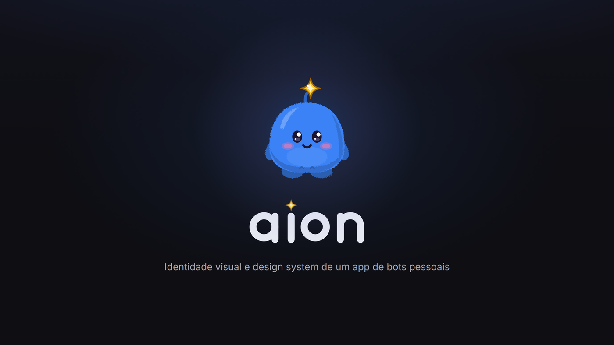
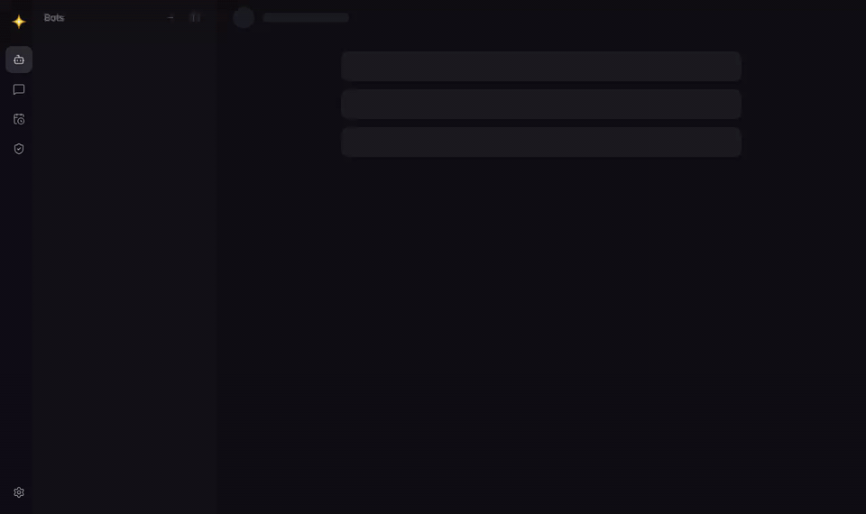
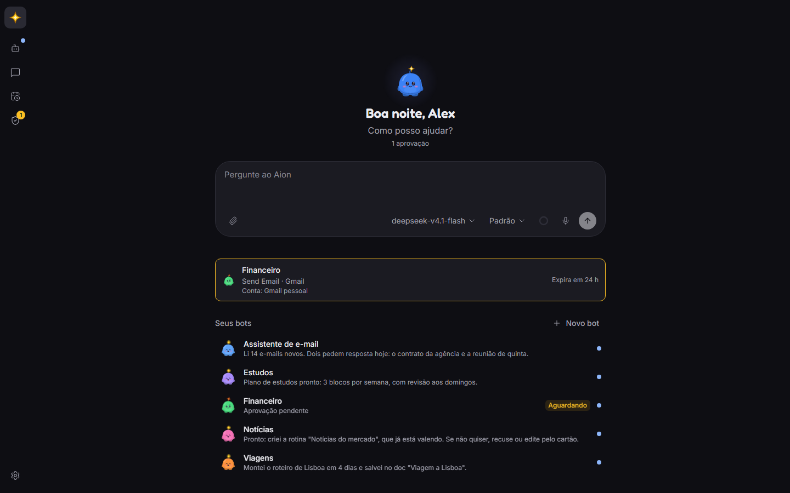
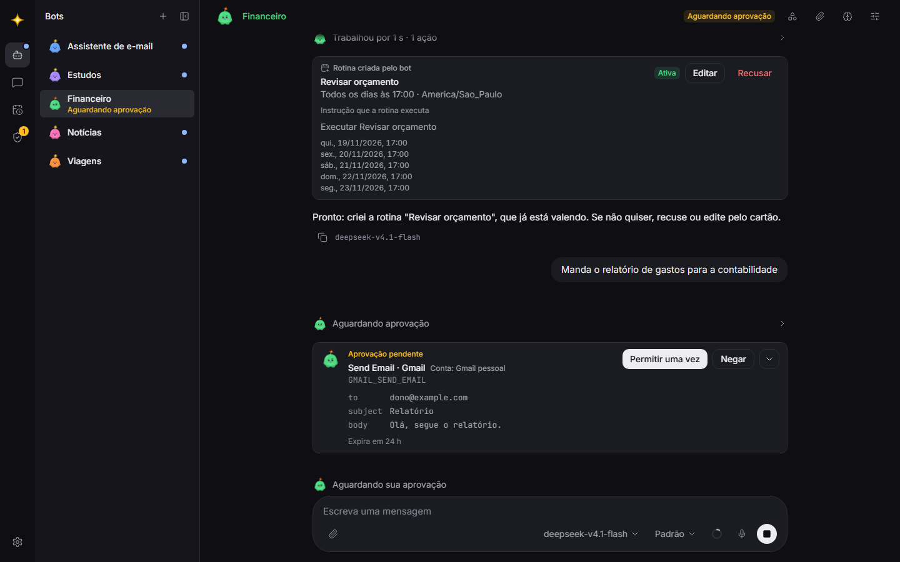
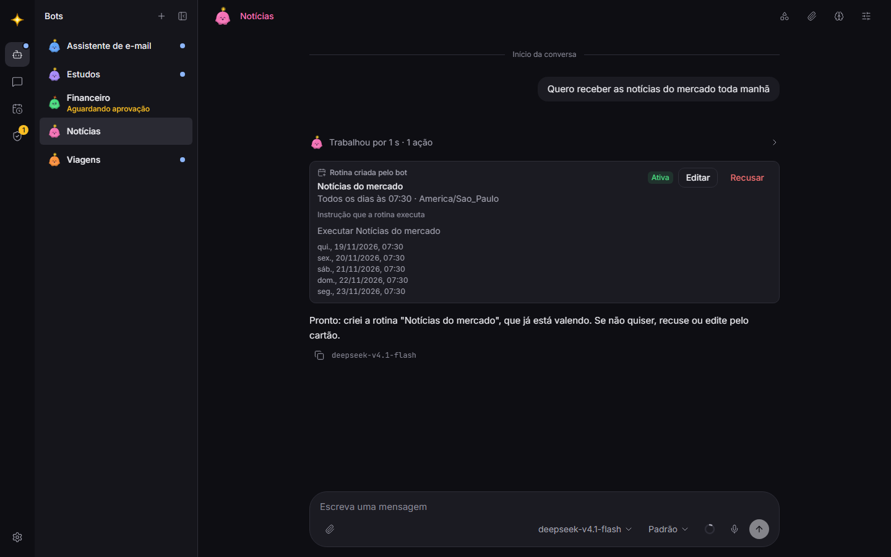
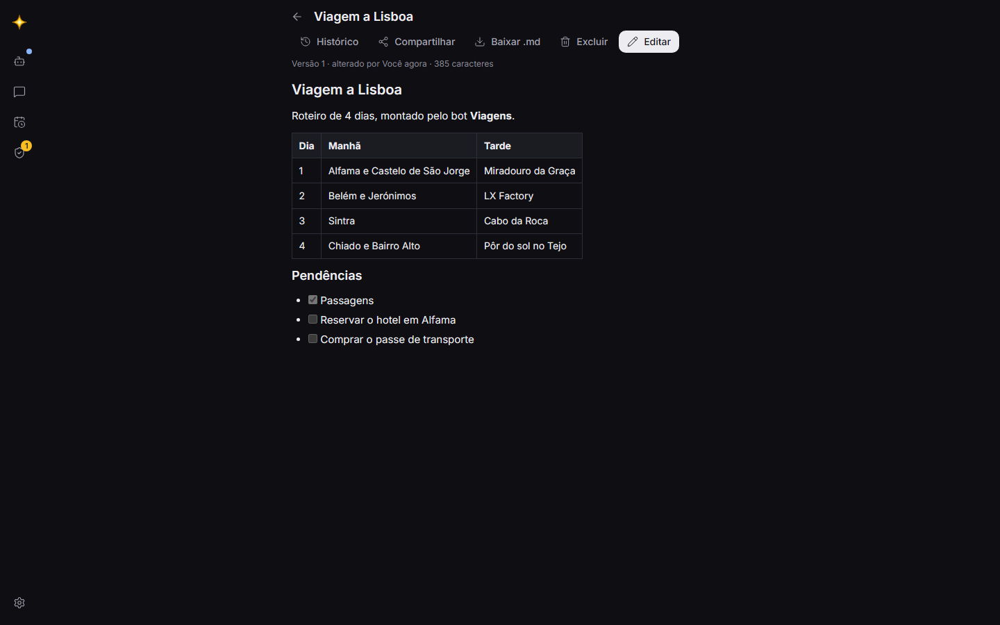
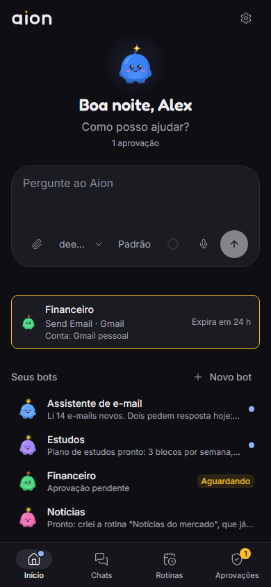
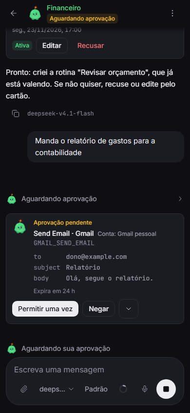
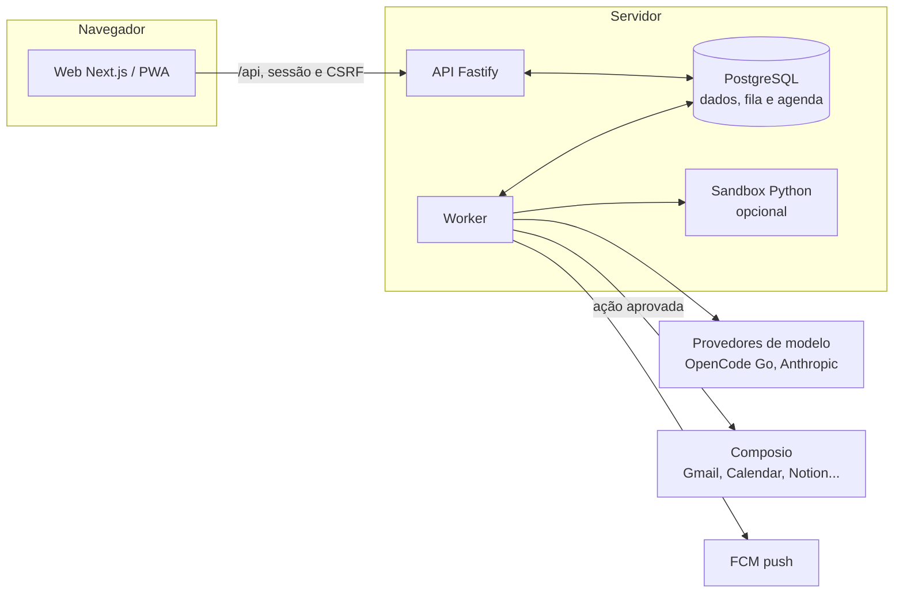

<div align="center">



### Seus bots trabalhando por você, em segundo plano, e pedindo licença antes de agir.

Aion é um app web auto-hospedado de bots autônomos para uma pessoa só. Cada bot tem conversa, memória, ferramentas e rotinas,
roda no seu servidor mesmo com o app fechado e pede a sua aprovação antes de qualquer ação que mexa no mundo real.

[](LICENSE.md)


[Recursos](#recursos) · [Capturas](#capturas) · [Como funciona](#como-funciona) · [Começar](#começar) · [Licença](#licença)

<br>



</div>

## Por que o Aion

A maioria dos assistentes de IA responde e esquece. O Aion foi feito para **delegar trabalho**: você cria bots com um papel
(e-mail, finanças, notícias, viagens), conecta as suas contas e deixa que eles executem, sozinhos ou em horários agendados.
O controle fica com você: toda ação externa passa por uma regra de aprovação aplicada no servidor, e cada decisão fica auditada.

- **Seu servidor, seus dados.** Um dono, uma instalação. Chaves de API criptografadas no banco e nunca enviadas ao navegador.
- **Autônomo de verdade.** Os bots rodam no worker, retomam do ponto exato depois de uma aprovação ou de um reinício e não
  dependem da aba aberta.
- **Permissão por ação.** "Permitir uma vez", "Sempre permitir" ou "Negar", por bot ou global, inclusive direto na notificação
  do celular.

## Recursos

| | |
|---|---|
| **Bots com memória** | Cada bot tem uma conversa contínua, objetivo, memória versionada e restaurável, e Regras Globais que valem para todos. |
| **Aprovações no servidor** | Ações externas pausam a execução e pedem aprovação com os parâmetros legíveis. A regra do bot prevalece sobre a global. |
| **Rotinas agendadas** | Diárias, semanais, mensais ou por dia útil, com fuso próprio. O bot pode propor uma rotina; você recusa ou edita pelo cartão. |
| **Conectores (Composio)** | Gmail, Google Calendar, Notion, GitHub e centenas de outros apps, com várias contas por app e liberação conta a conta por bot. |
| **Artefatos** | Tabelas relacionais e docs em Markdown com editor visual, versões restauráveis e compartilhamento com os bots. |
| **Python no sandbox** | `run_python` via Pyodide num serviço isolado e opcional, sem rede, com limites de tempo e memória. Gráficos viram anexos. |
| **Busca na web** | Pesquisa e leitura de páginas, com o conteúdo externo sempre tratado como dado não confiável. |
| **Anexos e ditado** | JPEG, PDF, DOCX, XLSX, JSON e texto; ditado pelo reconhecimento de voz do navegador. |
| **Notificações push** | Aviso por conversa e por aprovação, com Aprovar e Recusar na própria notificação e conteúdo opcional. |
| **Vários modelos** | OpenCode Go e Anthropic, escolha de modelo e esforço por conversa, curadoria do catálogo e relatório de custo por token. |
| **Contexto enxuto** | Compactação com checkpoint estruturado, cache de contexto do provedor e catálogo de ferramentas por grupos, para gastar menos. |
| **PWA e celular** | Instalável no Android e no desktop, com barra inferior no celular e tema escuro. |

## Capturas

<table>
  <tr>
    <td width="50%"><br><sub><b>Início.</b> Pendências e bots com a última novidade de cada um.</sub></td>
    <td width="50%"><br><sub><b>Aprovação.</b> A execução pausa e mostra exatamente o que o bot quer fazer.</sub></td>
  </tr>
  <tr>
    <td><br><sub><b>Rotinas.</b> O bot cria a rotina na hora; você recusa ou edita pelo cartão.</sub></td>
    <td><br><sub><b>Docs.</b> Markdown com editor visual, versões e acesso por bot.</sub></td>
  </tr>
</table>

<p align="center">
  
  &nbsp;&nbsp;
  
</p>

<sub>Capturas geradas com dados de demonstração e modelo simulado (`pnpm --filter @aion/web media:readme`).</sub>

## Como funciona



1. Você envia uma mensagem; a API grava e enfileira no PostgreSQL (pg-boss).
2. O worker monta o contexto, chama o modelo e executa as ferramentas pedidas.
3. Uma ação externa sem regra de "permitir" pausa a execução e vira um cartão de aprovação, com aviso no celular.
4. Aprovada, a execução retoma do ponto exato; o resultado entra na conversa como resposta ou cartão.

O navegador só fala com a API. Chamadas aos provedores e ao Composio, e as chaves deles, ficam exclusivamente no servidor.

## Começar

**Requisitos:** Node 24, pnpm (via Corepack) e um PostgreSQL. Os testes sobem um PostgreSQL embarcado e não precisam dele.

```bash
git clone <url-deste-repositório> aion && cd aion
corepack enable
pnpm install --frozen-lockfile
cp .env.example .env   # preencha DATABASE_URL, AION_OWNER_EMAIL, AION_OWNER_PASSWORD e AION_MASTER_KEY
```

Gere a chave mestra com `openssl rand -base64 32` e **guarde uma cópia fora do servidor**: sem ela, as chaves gravadas no banco
não podem ser lidas. Depois, cada serviço num terminal:

```bash
pnpm --filter @aion/api dev      # http://localhost:3001, aplica as migrations ao subir
pnpm --filter @aion/worker dev   # executa os bots e as rotinas
pnpm --filter @aion/web dev      # http://localhost:3000
```

Entre com o e-mail e a senha do dono e cadastre as chaves dos provedores e do Composio em **Configurações → Conexões**.

**Produção:** quatro serviços construídos por Dockerfile (`api`, `worker`, `web` e o `sandbox` opcional), web na raiz e API em
`/api` na mesma origem. `AION_PUBLIC_ORIGIN` é obrigatória em produção. O passo a passo completo, com variáveis por serviço,
push, sandbox, backup e migrations, está em [`docs/operacao.md`](docs/operacao.md).

## Segurança

- Sessão por cookie `HttpOnly`, `Secure` e `SameSite`, renovada pelo uso e revogável por aparelho; 2FA por TOTP opcional.
- CSRF por `Origin` e token em toda escrita; CSP com nonce, HSTS e demais cabeçalhos em todas as respostas.
- Chaves de API com AES-256-GCM sob a chave mestra do ambiente, exibidas só mascaradas.
- Limite de tentativas de login por IP e global, limites de taxa por rota e de tamanho de corpo.
- Conteúdo de web, e-mail e conectores entregue ao modelo dentro de uma moldura de dado não confiável.
- Auditoria das ações sensíveis sem registrar segredos nem conteúdo das conversas.

Encontrou uma vulnerabilidade? Abra um [security advisory privado](../../security/advisories/new) em vez de uma issue pública.

## Desenvolvimento

Monorepo pnpm em TypeScript:

| Pasta | Papel |
|---|---|
| `apps/web` | Next.js (PWA): interface e E2E com Playwright e axe |
| `apps/api` | Fastify: rotas HTTP e SSE, aplica as migrations ao iniciar |
| `apps/worker` | Execuções dos bots, rotinas, push e jobs de retenção |
| `apps/sandbox` | Serviço opcional do Python (Pyodide) |
| `packages/core` | Regras do sistema: banco, migrations, motor de execução, aprovações, memória, rotinas, tabelas e docs |
| `packages/shared` | Schemas Zod, tipos e códigos de erro compartilhados |

```bash
pnpm -r typecheck && pnpm -r lint
pnpm test                          # unitários e de integração (PostgreSQL embarcado)
pnpm --filter @aion/web test:e2e   # pilha de produção com provedor, Composio e push simulados
```

## Licença

O Aion é **source-available** sob a [Functional Source License 1.1, com licença futura Apache 2.0](LICENSE.md)
(FSL-1.1-ALv2). Não é open source no sentido da OSI enquanto a restrição vale, e vira Apache 2.0 dois anos depois de cada versão
publicada.

| Pode | Não pode |
|---|---|
| Usar no seu servidor, para você ou dentro da sua empresa | Vender o Aion, ou um serviço com a mesma função, a terceiros |
| Ler, estudar, modificar e redistribuir o código com a licença | Oferecer o Aion como SaaS ou produto concorrente |
| Usar em ensino e pesquisa não comerciais | Usar o nome Aion e a Faísca como marca de outro produto |
| Prestar serviços a quem usa o Aion dentro da licença | |

Quer usar o Aion de um jeito que a licença não cobre? Abra uma issue e conversamos.

<div align="center">
<br>
<sub>Feito por <a href="https://github.com/korflux">korflux</a></sub>
</div>
